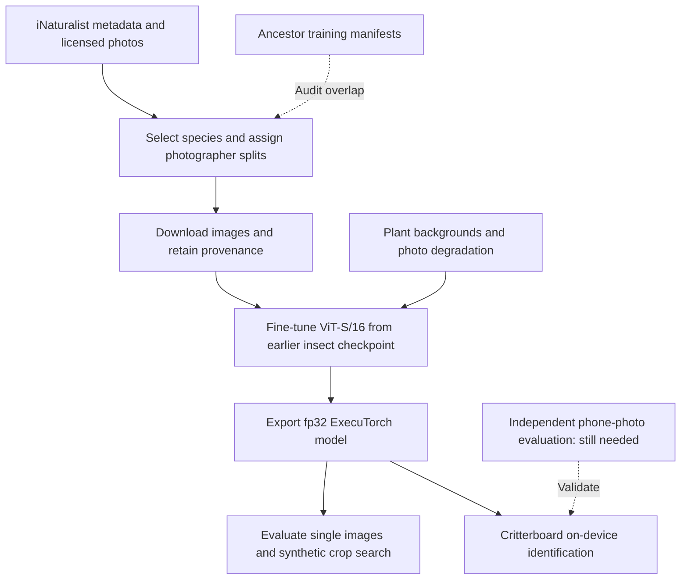

# Training an offline insect classifier: what improved, and what I still need to test

#ml #vision #training #draft

Draft for technical review · 22 October 2026

## Why I built it

I'm building [Critterboard](https://critterboard.app), an insect-collecting app that identifies insects and spiders on the phone. The species model is downloaded once; identification then works without a connection. I want someone to photograph an insect, get useful candidates and add a find to their collection without needing an account or uploading the photo.

The app is still in development. I haven't prepared an Android test release yet. This document is an invitation to review the vision training and evaluation approach; you don't need to install the app to help.

The current model covers 1,004 species. Its recorded top-1 score on the iNaturalist evaluation set is 82.4%, but that number needs an important qualification: while assembling this write-up, I found overlap between the later test manifest and an ancestor model's training manifest. I explain that below before interpreting the results.

Phone testing also exposed a more visible problem. A model trained on closely framed insect photographs struggled when the insect occupied a small part of an ordinary phone photo. I tried additional training on synthetic scenes to address that mismatch. The synthetic benchmark improved, but I don't yet have a measured real-phone benchmark to establish how much of that improvement transfers.

I'm looking for feedback on those two problems: how to establish a trustworthy evaluation, and what training change is worth trying after that.

## The current pipeline



Training uses PyTorch and `timm`. The app uses `react-native-executorch`; the exported model delegates supported operations to XNNPACK. The current artifact is a roughly 88.5 MB fp32 ViT-S/16 with 256 × 256 RGB input and 1,004 output logits. The app applies softmax and combines results from several crops.

This document concerns the species classifier. The app's conversational guide is a separate system.

## Choosing the data

The data pipeline uses iNaturalist's open-data metadata and photographs. The later species selection includes European insects and spiders ranked using research-grade and needs-ID observations. Household species are explicitly included because a list based only on research-grade observation counts can miss common insects that are difficult to identify from photos. Household observations can come from outside Europe.

The selection prefers research-grade photographs, with needs-ID photographs used to fill gaps. That makes label quality another question for review, especially for visually similar species.

The household-v3 credits manifest contains 248,378 photo records: 208,769 assigned to training, 15,010 to validation and 24,599 to test. It records 190,635 CC-BY and 57,743 CC0 photographs. These are manifest counts, not a promise that every remote image remains downloadable. The field-v7 run report records 208,628 training, 15,006 validation and 24,595 test images actually available to that run.

The selection generally caps a species at 250 photographs and a photographer at three photographs per species. Four later additions had only 68–99 photographs each. Their original combined test set contained just 38 images, so their individual scores are especially uncertain.

The base weights are Google's ViT AugReg checkpoint. The model cards describe the base-weight licence and the photo attribution records. Here, those records are also useful for auditing where data came from and whether it crossed split boundaries.

Sources: [household-v3 model card](../../training/vision/results/household-v3/MODEL_CARD.md), [credits manifest](../../training/vision/results/household-v3/credits.csv.gz), [selection code](../../training/vision/select_commercial.py).

## The split problem found during this write-up

The current splitting code assigns each observer to one split across species. That is an improvement over commercial-v1, which kept photographers separate within each species but allowed the same photographer into different splits for different species.

However, the training history matters:

```text
Google ViT AugReg → commercial-v1 → household-v2 → household-v3 → field-v7
```

Household-v2 was warm-started from commercial-v1, including the backbone and 896 matching classifier rows. Household-v3 continued from v2, and field-v7 continued from v3. Changing the split in a later stage doesn't remove what earlier checkpoints learned.

An exact photo-ID comparison of the archived credits manifests found:

| Later household-v3 split | Photo records | IDs also in commercial-v1's training manifest |
| --- | ---: | ---: |
| Validation | 15,010 | 4,210 |
| Test | 24,599 | 6,971 |

These are manifest intersections. They don't establish exactly how many overlapping images were successfully downloaded and consumed in each run. They do establish that the later split alone is insufficient evidence of an untouched evaluation set. I have not measured the amount by which this affects the scores.

I would therefore treat the recorded scores as development results. To make a stronger generalisation claim, I need an evaluation set checked against every ancestor's training data, or a fresh fine-tune from the base checkpoint using a fixed split throughout. Either approach still needs an independent phone-photo test.

The [evidence audit](vision-training-evidence.md) includes the manifest-comparison code and source locations. This caveat also applies to interpreting synthetic scenes drawn from the later test partition.

## Making the training images resemble phone crops

The failure that prompted field-v7 came from testing on an iPhone 13 mini. The app can start with a 12 MP photograph, but a small insect may occupy very few pixels. A crop around it is then resized to the model's input. Background, blur and missing detail can dominate the result.

I kept the architecture and class order and fine-tuned household-v3 for two more epochs. With probability 0.5, the training transform replaces the usual random crop with a synthetic scene:

1. Choose a plant background and crop it to a square.
2. Resize the source insect photograph so its longest side occupies 30–90% of that square.
3. Paste it at a random position with a feathered edge.
4. Degrade the image with downsampling and upsampling, JPEG compression, and probabilistic blur and noise.

This pastes the whole source photograph, including its original background. There is no insect segmentation mask. That is a deliberate simplification, but it creates a possible shortcut: the model could learn compositing artifacts that don't occur in real phone photos.

The general transform also applies degradation with probability 0.3 after choosing the crop or synthetic branch. Synthetic samples already receive degradation inside their own transform, so some receive it twice. Horizontal flips, TrivialAugmentWide and random erasing follow.

The recorded run used 256 px input, batch size 48, AdamW, label smoothing 0.1 and drop-path 0.1 on Apple M1 MPS in fp32. The command's `--lr 1e-4` is a scale parameter: the code starts the backbone group at 5e-5 and the classifier group at 5e-4, before its schedule. The two recorded epoch durations total about 5 hours 51 minutes; that excludes data preparation and evaluation.

Sources: [augmentation](../../training/vision/field_aug.py), [training loop](../../training/vision/train.py), [field-v7 card](../../training/vision/results/field-v7/MODEL_CARD.md).

## Evaluating the path the app uses

I evaluate the exported `.pte` model as well as the training model. Export and preprocessing are part of the system being tested.

The synthetic benchmark takes one photograph per species for the first 500 species in its species list. It places each source photograph on a test background in a 1512 × 2016 frame, with a large and small version. “Small” means the pasted photograph's long side is 15–25% of the viewfinder target area's side; the insect itself is not measured or boxed.

Each scene runs through a Python counterpart of the app's crop search:

- **Automatic:** a 3 × 3 tile grid plus three centred crops. It selects the strongest tile prediction and averages it with the three centred predictions.
- **Tapped:** three differently sized crops around an approximately centred tap; it selects the crop with the highest maximum score.
- **Live-preview proxy:** just the central target-area crop. It does not simulate a sequence of actual camera preview frames.

The benchmark is deterministic, uses held-out background photo IDs and reports 500 predictions per condition. It shares compositing machinery with training, covers only part of the class list and inherits the checkpoint-history caveat above. Its Python resizing is also not a byte-for-byte reproduction of the native image pipeline.

### Recorded results

Top-1 means the first candidate is correct; top-3 means the correct species is among the first three candidates.

| Evaluation | Household-v3 top-1 / top-3 | Field-v7 top-1 / top-3 |
| --- | ---: | ---: |
| Available iNaturalist test images, single-image inference | 82.8% / 93.1% | 82.4% / 92.7% |
| Synthetic large subject, automatic search | 74.6% / 84.2% | 78.4% / 89.0% |
| Synthetic large subject, tapped | 79.8% / 89.0% | 81.2% / 90.0% |
| Synthetic small subject, automatic search | 14.4% / 21.0% | 33.8% / 44.0% |
| Synthetic small subject, tapped | 22.6% / 29.2% | 46.0% / 59.6% |

The largest recorded gain is 23.4 percentage points for small synthetic subjects with a tap. The single-image top-1 score falls by about 0.4 points. These results support investigating the augmentation further; they don't establish a doubling of real-world identification accuracy. There is also no matched two-epoch continuation without field augmentation here, so extra training and augmentation have not been isolated from one another.

The export report records 94.7 ms per image on the Mac host. That is not phone latency or end-to-end scan latency: crop search performs several inferences, and camera handling and preprocessing add work.

Source: [recorded evaluation JSON](../../training/vision/results/field-v7/field.json).

## Confidence still needs work

After a shot, the evaluated app policy goes directly to a result when the top score is at least 0.7 and exceeds the second score by at least 0.15. For small tapped synthetic scenes, field-v7 did that on 134 of 500 examples; 116 of those 134 predictions were correct. Its greater willingness to give a direct answer still included 18 wrong answers.

The temperature search selected T = 1.0 across 1,200 synthetic validation predictions. That means no tested global temperature improved the chosen aggregate negative log-likelihood objective. It does **not** show that every path is calibrated: the best temperatures by condition ranged from 0.85 to 1.15.

The model is also a closed-set classifier. It has to score one of its known species even when the photograph contains an unknown insect, a plant or no insect at all. A softmax threshold alone has not been validated here as an unknown-species detector.

Sources: [calibration code](../../training/vision/calibrate.py), [recorded confidence results](../../training/vision/results/field-v7/field.json).

## What I would like reviewed

Feedback on one question is enough; there's no need to review the whole pipeline.

1. **Evaluation independence.** Given the checkpoint ancestry and manifest overlap, what would you require before trusting a new score? Would you prioritise a fresh split and retrain, an independently collected phone dataset, or both?
2. **Synthetic-to-real transfer.** Which small ablation would best test whether this augmentation helps: continued training without compositing, degradation alone, or compositing alone? What failure cases would distinguish a useful transform from a compositing shortcut?
3. **Unknown and ambiguous species.** How should I evaluate rejection and genus-level answers when species-level identification is impossible from the photograph? Which negative examples are essential?
4. **Crop search and confidence.** What would you compare against the current best-crop/averaging policy within a phone's latency and memory budget? How should confidence be assessed separately for automatic search and taps?
5. **Field test design.** How would you construct a practical first dataset across phones, photographers, lighting, subject size and difficult species? How should uncertain ground-truth labels be handled?

My proposed next experiment is to freeze both existing models, collect independently labelled phone photos, check their provenance, and compare the same inputs through the same crop path. I'd report per-condition results, rejection behaviour and measured device latency. I would keep a separate final set out of threshold tuning and model selection.

The training code and existing results are in the [Critterboard repository](https://github.com/krzysztofradomski/critterboard). If you review this draft, a section reference, the concern and the smallest useful next experiment would help me act on the feedback. Critterboard's [project page](https://critterboard.app) has the app context; the immediate request here is for technical review.

## Source map

| Source | Use in this draft |
| --- | --- |
| [Vision pipeline README](../../training/vision/README.md) | Pipeline history and entry points; some introductory instructions describe older runs. |
| [Commercial-v1 card](../../training/vision/results/commercial-1k-v1/MODEL_CARD.md) | Ancestor data and original per-species split. |
| [Household-v3 card](../../training/vision/results/household-v3/MODEL_CARD.md) | Species additions, warm-start history and data records. |
| [Field-v7 card](../../training/vision/results/field-v7/MODEL_CARD.md) | Augmentation intent, runtime and acknowledged synthetic-test limitations. |
| [Field-v7 run artifacts](https://github.com/krzysztofradomski/critterboard/tree/field-v7-results/training/vision/results/field-v7) | Checkpoint, run report, package lock and export report. |
| [Household training script](https://github.com/krzysztofradomski/critterboard/blob/household-v2-results/training/vision/household_retrain.sh) | Explicit warm-start from commercial-v1. |
| [Evidence audit](vision-training-evidence.md) | Recomputed counts, discrepancies and checks before publication. |

Related project notes: [[../ml-roadmap]], [[../modules/training-contributions]].
