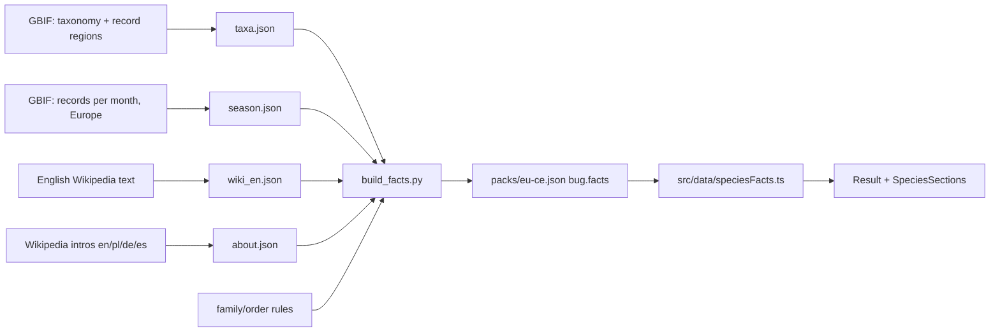
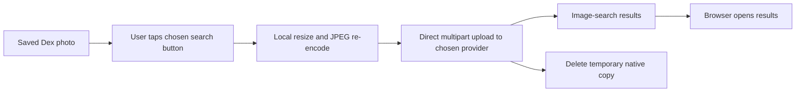

#species #data #education

# Species facts

The species card (Result screen) is built from `Bug.facts`, made offline by `tools/facts/` and shipped inside the region pack JSON. Bundled species get the same facts once the pack is installed (pack entries replace them by id); without a pack the card shows only the photo, names and actions.

Top to bottom:

- **Hero**: your photo (from the scan, or your catch's photo), name, Latin name, order in plain words · family.
- **Badges**: garden friend / can be a pest, pollinator, eats aphids, hunter, recycler; a **safety** line (harmless, can bite, can sting, tick, irritating hairs).
- **About**: two sentences from Wikipedia in the UI language (credited CC BY-SA), else just the "read more" link.
- **Facts grid**: habitat, size (or family), range, diet, with "typical for its family" underneath.
- **Your catch**: date caught, "Show on map" when it has coordinates (opens the Map on that point).
- **How big?**: the size next to an everyday object (sesame seed … phone), two bars to scale.
- **When to look**: records per month in Europe as 12 bars, the busiest stretch in words, and "spotted N× near you" when shared sightings are on.
- **Life cycle**: stages from the order (complete / incomplete metamorphosis, spiders, ticks and mites).
- **Check this ID**: on saved Dex entries with a photo, Google Lens / Bing Visual Search actions send the selected photo directly and open the results.
- **Actions**: Share (photo + text on iOS, text on Android) once caught; Remove from Dex is a small link.



## Where each value comes from

| Tile | Source | How reliable |
|---|---|---|
| Range | GBIF occurrence counts per region (kept when ≥1% and ≥20 records) | Good, but reflects where people *record* species |
| Size / wingspan | First length or wingspan sentence in the English Wikipedia article (~75% of species) | Good; mm/cm range, otherwise the tile shows the family |
| Habitat | Rules by order/family in `build_facts.py` | **Typical for the family**, not species research |
| Diet | Same rules | **Typical for the family**; texts say "mostly" where families differ |
| Family | GBIF taxonomy | Good |
| Season (`m`) | GBIF records per month in Europe, 0–9 relative to the busiest month | Good; shows when people *record* it, which follows when it's active |
| About (`ab`) | First two sentences of the Wikipedia intro per language; kept only when the intro names the binomial | Good; missing where that language has no article |

Computed in the app (`src/data/speciesFacts.ts`, unit-tested), so a fix needs no pack rebuild:

| Rule | From | Note |
|---|---|---|
| Order in plain words | `o` | `facts.order.*` |
| Badges | traits + diet key | pollinator, eats aphids, hunter, recycler |
| Garden friend / pest | curated genus and species lists, then badges | Pest wins; the list includes the coming household species |
| Safety | family and genus | Ticks, stinging families, biting families, irritating caterpillars and blister beetles; everything else "harmless" |
| Life cycle | order | Unknown orders show nothing |
| Size comparison | `sz` midpoint | Closest everyday object by ratio |

Texts are translated (`facts.habitatOf.*`, `facts.dietOf.*`, `facts.region.*`) in all four languages. The card also links to the species' Wikipedia page in the UI language.

## Checking a Dex photo online

`ImageSearchCard` sits between Life cycle and Share, only on saved Dex entries with a photo (not a fresh scan). The Google Lens and Bing Visual Search buttons send the photo on one tap; saving and uploading it manually is no longer part of the flow. The cream sticker, ink borders and palette match the surrounding cards. All copy and accessibility labels are translated into English, Polish, German and Spanish.

The notice above the buttons states that tapping sends a resized copy of this photo to Google or Microsoft under their privacy policies. Only a deliberate tap starts preparation or upload. Both buttons are disabled while sending; failures stay visible and never silently retry through the other provider. This is independent of the optional Critterboard network/training settings: the explicit search action sends directly to the selected provider, with no Critterboard account or backend.

`prepareSearchPhoto.ts` resolves moved iOS container paths, decodes the selected image and re-encodes a JPEG with a longest side of at most 1600 px. Re-encoding removes the original EXIF/GPS metadata. Native image resources are released and the temporary file is deleted after the upload, including failures. The web implementation uses a canvas and closes its decoded bitmap; it does not keep intermediate blob URLs.

### Native upload and browser handoff

`searchPhoto.ts` checks the local file, then sends multipart directly with the installed `expo/fetch` and `expo-file-system` modules:

| Provider | Upload endpoint | Multipart field |
|---|---|---|
| Google Lens | `https://lens.google.com/v3/upload?hl=<language>` | `encoded_image`: JPEG file |
| Bing Visual Search | `https://www.bing.com/images/detail/search?iss=sbiupload&FORM=CHROMI` | `imageBin`: raw JPEG base64, without the data-URL prefix |

The request omits cookies, has a 30-second deadline, and uses manual redirects. `imageSearchResultsUrl` accepts only HTTPS results on the chosen provider's exact hostname and search path with an image-session token. Relative Bing results links are resolved against Bing. Only the validated result link is passed to `Linking.openURL`; links, provider cookies and response bodies are not stored or logged. There is no public photo URL, hosting or paid API.

### Web upload

`searchPhoto.web.ts` reserves a tab within the original click before asynchronous image preparation, so browser popup blocking can be reported accurately. It creates a multipart form in that tab and submits into the same tab. A no-referrer policy prevents the unrelated app origin being sent with the form. Google uses its `/upload` browser flow: `/v3/upload` can send browser POSTs through a cookie-consent redirect before processing the photo, losing the POST. The browser `/upload` route processes the photo first, preserving it through any cookie choice on the results page. Bing uses the same endpoint as native.

Google uses a prepared `File` in the `encoded_image` input; Bing uses the base64 string in a hidden `imageBin` input. The browser posts directly to the provider. Local blob/data photos are supported; arbitrary remote URLs are not fetched. Provider cookie choices or anti-abuse prompts remain in the provider's browser interface.



These are consumer upload flows used by Chromium, not a guaranteed public API contract. `imageSearch.ts` centralizes endpoint and results validation for future changes. Source: [Chromium Lens form](https://chromium.googlesource.com/chromium/src/+/HEAD/chrome/browser/resources/new_tab_page/lens_form.ts), [Lens multipart field](https://chromium.googlesource.com/chromium/src/+/HEAD/chrome/browser/resources/new_tab_page/lens_form.html), [Chromium search-provider definitions](https://chromium.googlesource.com/external/search_engines_data/+/HEAD/definitions/prepopulated_engines.json). Related: [[training-contributions]] (separate opt-in uploads for Critterboard training).

## Updating

```bash
python3 tools/facts/fetch_taxonomy.py   # GBIF, ~5 min (throttled)
python3 tools/facts/fetch_wiki.py       # Wikipedia, ~3 min
python3 tools/facts/fetch_season.py     # GBIF records per month, ~5 min
python3 tools/facts/fetch_about.py      # Wikipedia intros in 4 languages, ~5 min
python3 tools/facts/build_facts.py      # writes packs/eu-ce.json, bumps its version
```

Then bump `packs/manifest.json` to the new pack version. Related: [[i18n]], [[backend-adapter]].
