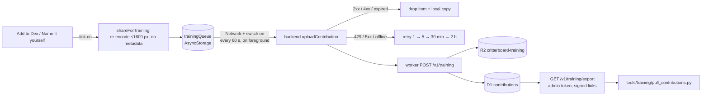

# Name it yourself + training contributions

`#architecture` `#ml` `#privacy` `#api`

Two connected features (spec: [[../superpowers/specs/2026-10-09-name-it-yourself-and-training-contributions-design]]):

- **Name it yourself:** when the model gets a bug wrong or finds nothing, the player searches the region pack's species by name and adds the right one.
- **Help train the model:** an opt-in to share labelled photos, both those self-named ones and model IDs the player confirmed, so the next species model learns from real phone photos.

> See also: [[backend-adapter]] (the network seam and its Network gate), [[../ml-roadmap]] (why real phone photos matter), [[species-facts]].

## Name it yourself

- **Where:** "Not right? Name it yourself" on Result (a fresh scan with a photo), Disambiguate and NoMatch. Never without a photo.
- **Search** (`src/lib/speciesSearch.ts`): the app-language name, the English name and the Latin name, case- and accent-insensitive. ł and ß are mapped by hand, since NFD doesn't split them. Results: name starts first, then word starts, then substrings; commoner species first, then alphabetical. Before typing, the model's top 3 are shown.
- **Sheet** (`src/components/NameItSheet.tsx`): search, then a confirm card with the photo next to the species icon.
- **The catch** is saved through `useAddCatch` (shared with Result's Add to Dex) as `source: 'manual'`:
  - **Counts:** Dex, quests, streak, map pin, the "named by you" tag.
  - **Doesn't count:** it is **never uploaded**. `pendingCatches` and `usePublishCatch` skip it, so there's no leaderboard XP, feed event or shared sighting.
  - **Local XP:** `scoredSpecies` counts only species with a model catch, so the in-app level matches the server.
  - **Backups** keep `source`.

## Help train the model



**Consent:**
- A Brains switch (`profile.trainingShareOn`), off by default and disabled while Network is off. The first switch-on explains what is sent.
- While it's on, Add to Dex and the Name-it confirm card show a "Share this photo for training" tick, on by default (`ShareTick`).

**What one contribution is** (`src/lib/contributions.ts`, validated again by `worker/src/trainingRules.ts`):
- the species (`bug_id`, Latin name)
- `kind`: `manual` or `confirmed`
- the model's top 3 with scores
- where the bug is, as photo fractions: a tap point or the reticle (`aimFractions` in `scanCrops.ts`)
- pack and model version
- the credit name (the in-app name, or "Critterboard player"), and `licence: CC-BY-4.0`

**Never sent:** a location, EXIF or device details. The photo is re-encoded into a new JPEG (long side ≤ 1600 px, quality 0.85), and the worker drops any field it doesn't know.

**On the phone** (`src/backend/trainingQueue.ts`):
- The queue lives under its own storage key, so a scan never waits on the network.
- `useTrainingUploader` (mounted in `App.tsx`) drains it one photo at a time.
- Sent, refused (4xx), expired (7 days) or missing-file items are dropped, together with their local copy.
- "Wipe everything" clears the queue. "Delete shared photos" clears it and calls `DELETE /v1/training/mine`.
- **Marker on the Dex entry.** Every caught species with a photo in training shows a marker: a corner badge on its Dex tile, and a band along the bottom of the photo on its species page.
  - Green 🎓 "Shared for training": the server accepted a photo of this species.
  - Yellow ⏳ "Waiting to share": a photo is queued on the phone.
  - The shared marks are species ids, saved next to the queue (`critterboard:training-shared:v1`, `sharedBugIds` in `src/backend/trainingQueue.ts`) and read through `useTrainingMarks`.
  - They are forgotten when shared photos are deleted on the server, online data is deleted, the app is wiped, or that species is removed from the Dex.
  - Photos shared before this marker existed (13 Oct 2026) aren't marked: the server only reports a count.

**On the worker** (`worker/src/training.ts`):

| Route | Who | What |
|---|---|---|
| `POST /v1/training` | player (JWT) | multipart `meta` + `photo` (JPEG ≤ 2 MB). Pack species only; idempotent per id; 200 a day per player |
| `GET /v1/training/mine` | player | `{ count }` |
| `DELETE /v1/training/mine` | player | deletes the player's photos and rows |
| `DELETE /v1/account` | player | also deletes them |
| `GET /v1/training/export` | developer (`TRAINING_ADMIN_TOKEN`) | rows with a pseudonymous `contributor` (keyed by `TRAINING_PSEUDONYM_SECRET`: set once, never rotate) and 1-hour signed photo links, plus `deleted` ids (tombstones) |

**For training** (`tools/training/pull_contributions.py`):
- Downloads into `contrib/<split>/<taxon_id>/<id>.jpg`.
- The split comes from the contributor pseudonym, so one player never straddles train and test.
- Writes `manifest.csv`, and `credits.csv` for the next model's `ATTRIBUTION.md` (CC BY needs credit).
- Removes photos and CSV rows of contributions players deleted since the last pull (the export's tombstones), so a delete reaches the local dataset too.

## Deploy (the developer's call)

```bash
cd worker
wrangler r2 bucket create critterboard-training
wrangler d1 execute critterboard --remote --file=migrations/0001_training_contributions.sql
wrangler secret put TRAINING_ADMIN_TOKEN
wrangler secret put TRAINING_PSEUDONYM_SECRET   # once; never rotate (it keys the train/test split)
wrangler deploy
```

The deploy also ships the species list fix: the 108 species added in pack v13 earned 0 leaderboard XP before it. Then a new app build: older builds never show the switch.

## Why these choices

- **Pack species only:** a Dex card needs names, an icon and facts. Free text would also make noisy labels.
- **No leaderboard score for self-named catches:** otherwise anyone could type their way up.
- **CC BY 4.0:** the same licence as the iNaturalist photos the models train on, so one credits pipeline covers both.
- **Stored on R2 behind the existing worker:** it reuses the worker's JWT auth, rate limits and account deletion.
