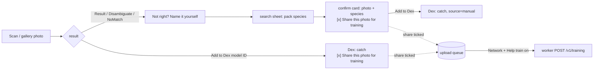

# Name it yourself + training contributions — design

`#spec` `#ml` `#privacy` `#api`

**Date:** 2026-10-09 · **Status:** approved in conversation, awaiting written review

## Goal

1. **Name it yourself.** Players can add a bug the model got wrong, or didn't recognise, to their Dex by searching the region pack's species by name and confirming.
2. **Training contributions.** Players can opt in to share labelled photos (ones they named themselves, and model IDs they confirmed) with the developer, under CC BY 4.0, to train the next model.
3. Update the FAQ, privacy page, README and Brains screen to match.

## Decisions (from the conversation)

| Question | Decision |
|---|---|
| Which species can be searched | The region pack's species only (1,108 in `eu-ce` v14, of which the model knows 1,004) |
| How a self-named catch counts | Dex, quests and streak yes; leaderboard score and shared sightings no; tagged "named by you" |
| Where the search starts | Only after a photo (camera or gallery): Result, Disambiguate, NoMatch |
| Consent | A Brains switch "Help train the model", off by default and requiring Network; while it's on, a per-photo "Share this photo for training" tick, on by default |
| Which photos | Self-named (`manual`) and model IDs the player confirmed (`confirmed`) |
| Licence | CC BY 4.0, credited to the player's in-app name ("Critterboard player" if none) |
| Storage | Approach A: Cloudflare R2 bucket + D1 index behind the existing worker |

## 1. User flow



- **Override link:** "Not right? Name it yourself" on Result (below the main action), on Disambiguate (under the candidates) and on NoMatch (main action). It appears only when the screen has a photo.
- **Search sheet:**
  - Lists pack species by the app-language name (`names[lang]`, falling back to `name`), with the Latin name below.
  - The query matches the app-language name, the English `name` and the Latin name. Matching is a case- and accent-insensitive substring match (NFD, strip combining marks): "biedronka", "ladybird", "coccinella" and "Biedronka azjatycka" all find `harl`.
  - Order: prefix matches first, then other matches. Within each, more common rarity first, then alphabetical.
  - With an empty query, the model's top 3 are shown first (when known), as "The model thought:".
  - No match shows "Not in this region's list" and nothing else. There is no free-text entry.
- **Confirm card:**
  - Shows the player's photo next to the species icon, the app-language name and the Latin name.
  - The tick "Share this photo for training (CC BY 4.0, credited as <name>)" shows only while Help train is on, ticked by default.
  - Buttons: **Add to Dex** and **Cancel**.
- **Catch:** `catchBug(id, { …, source: 'manual' })`. The Dex detail and the Result for that catch show a small "named by you" tag.
- **Confirmed model IDs:** while Help train is on, Result's Add to Dex step shows the same tick next to the button, ticked by default. Ticked means the photo is queued as `confirmed`.

## 2. Game rules for manual catches

- `CatchEvent.source?: 'manual'` (absent = model catch, so older data reads as model catches).
- **Count as usual:** Dex membership, quest progress, streak, activity log and the "your catch" card.
- **Not counted:** `usePublishCatch` and the catch backfill (`src/backend/sync.ts`) skip `source === 'manual'`. So no leaderboard XP, no feed events and no shared sightings.
- **Local XP:** `useXp` (`src/lib/level.ts`) counts only species with at least one model catch, so the local level matches the server's. Today it uses `xpFromDex(dex)`, which would count manual species; the server scores the distinct species of published catches only. Quest XP is unchanged.
- **Backups:** export and restore carry `source` (backup format: add the optional field, no version bump needed if the reader ignores unknown fields; check `docs/modules/backup-restore.md`).

## 3. Training contribution

### What one contribution is

The JPEG and a JSON record:

| Field | Example | Notes |
|---|---|---|
| `id` | `"c_01J…"` | client-generated (ULID), idempotency key |
| `bug_id` | `"harl"` | must be a pack species id |
| `latin` | `"Harmonia axyridis"` | as in the pack |
| `kind` | `"manual"` / `"confirmed"` | |
| `top3` | `[{"bug_id":"cocc","p":0.41}, …]` | the model's guesses for this photo; `[]` when unknown |
| `model_version` | `7` | from the installed pack |
| `pack_version` | `14` | |
| `aim` | `{"tap":[0.42,0.61]}` or `{"reticle":[0.5,0.46,0.36]}` or `{}` | fractions of the photo's width/height (reticle side as a fraction of the short side) |
| `credit_name` | `"Krzysztof"` | in-app name at upload time, else "Critterboard player" |
| `licence` | `"CC-BY-4.0"` | fixed |
| `at` | `1791490000000` | capture time, ms |

**Never sent:** location, EXIF (the photo is re-encoded with `expo-image-manipulator`: long side ≤ 1600 px, JPEG 0.85, about 300 KB, which drops all metadata), the device model and the persona.

### Getting top-3 and aim to the confirm screens

Scan already computes the candidates and knows the aim (a tap point, or the reticle mapped into the photo). It passes them to Result, Disambiguate and NoMatch as new optional route params: `top3` and `aim`, with `aim` already in photo fractions. Gallery picks have no aim, and their search area is the photo centre, so they send `{}`.

### App pieces

- `src/lib/speciesSearch.ts`: pure. `searchSpecies(bugs, query, lang, top3?) → Bug[]` and `fold(s)` (accent folding).
- `src/components/NameItSheet.tsx`: the search sheet and the confirm card.
- `src/store`: in the existing persisted store,
  - `profile.trainingShareOn: boolean` (default false)
  - `trainingQueue: QueueItem[]`, where `QueueItem = { contribution, photoUri, tries, nextAt, addedAt }`
  - `enqueueContribution` and `dropContribution`
  - `trainingSharedCount` (cached from the server; shown in Brains)
- **Upload loop** (`src/backend/hooks.ts`, `useTrainingUploader`):
  - Runs when `networkOn && trainingShareOn`, on app foreground and every 60 s while there are items.
  - Uploads one item at a time.
  - **2xx:** drop the item, and the local copy of the re-encoded photo.
  - **429 or 5xx or network error:** retry with backoff 1 min → 5 → 30 → 2 h.
  - **Other 4xx:** drop (a bad request will never succeed).
  - Also drop items older than 7 days, or whose photo file is gone.
  - Turning the switch off pauses the loop and keeps the items.
- **Adapter:** `BackendAdapter.uploadContribution(c, jpegUri)`, `fetchContributionCount()` and `deleteContributions()`, in both the mock and `cloudflare.ts`. Calls stay behind the hooks layer and the Network gate, as the adapter doc requires.

### Worker (`worker/`)

- **Bindings:** R2 bucket `TRAINING` (`critterboard-training`) and secret `TRAINING_ADMIN_TOKEN`.
- **D1** (`schema.sql`; migration for the live DB):

  ```sql
  CREATE TABLE IF NOT EXISTS contributions (
    id TEXT PRIMARY KEY, user_id TEXT NOT NULL, bug_id TEXT NOT NULL, latin TEXT NOT NULL,
    kind TEXT NOT NULL, top3 TEXT NOT NULL, model_version INTEGER, pack_version INTEGER,
    aim TEXT NOT NULL, credit_name TEXT NOT NULL, licence TEXT NOT NULL,
    at INTEGER NOT NULL, created_at INTEGER NOT NULL, r2_key TEXT NOT NULL, bytes INTEGER NOT NULL
  );
  CREATE INDEX IF NOT EXISTS contributions_user ON contributions(user_id);
  CREATE INDEX IF NOT EXISTS contributions_created ON contributions(created_at);
  ```

- **`POST /v1/training`** (JWT, `API_LIMITER`): multipart, with a `meta` JSON part and a `photo` image/jpeg part.
  - **Rejected with 400:** an unknown `bug_id` (not in `SPECIES_XP`), a `kind` other than `manual`/`confirmed`, a photo over 2 MB or not starting with the JPEG magic bytes, a `credit_name` over 40 characters, or a malformed `top3`/`aim`.
  - **Rejected with 429:** a daily cap of 200 per user, counted in D1 by `created_at`.
  - **Idempotent on `id`:** a repeat returns 200 with no new object.
  - Stores at R2 key `<yyyy-mm>/<bug_id>/<id>.jpg`, then the row. If the row insert fails, the object is deleted.
- **`GET /v1/training/mine`** returns `{ count }`. **`DELETE /v1/training/mine`** deletes the player's R2 objects and rows.
- **`DELETE /v1/account`** also deletes the player's contributions.
- **`GET /v1/training/export?since=<ms>&limit=500`** needs `Authorization: Bearer <TRAINING_ADMIN_TOKEN>`, compared in constant time. It returns rows plus a short-lived download path per object: `GET /v1/training/object/<id>?sig=…`, an HMAC with the admin token, valid for 1 h.
- **Step 0 (existing bug):** `worker/src/speciesXp.ts` lacks the 108 species added in pack v13, so their catches earn 0 leaderboard XP. Regenerate it with `tools/worker/gen_species_xp.py`. The training endpoint validates against the same list.

### Developer tooling

`tools/training/pull_contributions.py --since … --out $DATA`:
- Pages through the export and downloads each JPEG to `contrib/<split>/<taxon_id>/<id>.jpg`, where `split` comes from a hash of `user_id`, so one player's photos never straddle train and test.
- Writes `contrib/manifest.csv` (all fields) and `contrib/credits.csv` (credit_name, licence, photo id), for the next model's `ATTRIBUTION.md`.
- Reads the token from `CRITTERBOARD_TRAINING_TOKEN`.

## 4. Copy and docs

Written natively per language (en/pl/de/es), not translated word for word (`tasks/lessons.md`). Non-English copy is shown to the developer before it ships.

- **FAQ** (`assets/i18n/*.json` → `help.faq`, plus `FAQ_IDS` in `Help.tsx`):
  - New faq9, "The app got my bug wrong, can I fix it?": "Name it yourself", pack-only, doesn't count for the leaderboard.
  - New faq10, "What does 'Help train the model' share?": what's sent and never sent, CC BY credit, Delete, that photos already used in a released model stay in that model, and that it needs Network.
  - faq2 gets a pointer to naming.
  - The website support page is regenerated (`python3 tools/website/gen_site.py`); the outputs and sources are committed together.
- **Privacy page:** a "Training contributions" section in `tools/website/legal_content.py`, then regenerate.
- **Brains** (`Settings.tsx`), next to the other network switches:
  - The "Help train the model" switch, disabled while Network is off. Turning it on the first time opens an explainer sheet with what's shared, the licence and the credit name. Turning it off just stops sending.
  - The row "N photos shared · N waiting" and "Delete my shared photos", behind a confirm.
- **README:** a features bullet.
- **Docs:** `docs/modules/training-contributions.md` (new: flow, payload, privacy, pull script), `docs/modules/backend-adapter.md` (new methods), `docs/README.md` (index), `tasks/todo.md`.

## 5. Failure handling

- An upload failure never blocks or undoes a catch.
- Queue rules are as in §3. Delete my shared photos also clears the local queue.
- Wipe everything (`wipeAll`) clears the queue and the switch. Contributions already uploaded stay on the server unless the player deleted them first. The FAQ says so, and Delete account removes them.
- Uploads work offline-first: queued while offline and sent once Network is back.

## 6. Testing

- **App unit tests (vitest):**
  - `speciesSearch`: accents, Latin, each language, fallback to `name`, ordering, top-3 first on an empty query.
  - Store: `source` stored; queue enqueue, drop and backoff transitions.
  - Manual catches skipped by publish and backfill.
  - Contribution payload: no location fields; `aim` as fractions for tap, reticle and gallery.
- **Worker:** extend `smoke.mjs` (local `wrangler dev` with an R2 store):
  - Auth required.
  - Rejects: unknown `bug_id`, bad kind, a non-JPEG, more than 2 MB.
  - Idempotency.
  - The daily cap (with a lowered cap var).
  - `mine` count and delete.
  - Delete account cascades.
  - Export: token checked, signed object link works and expires.
- **Simulator:** a wrong ID → Name it yourself → search "biedronka" → confirm with Share → the Dex shows "named by you" → the Brains count goes up (mock adapter). Against the real worker, only after the developer deploys.

## 7. Rollout (needs the developer)

The repo holds the commands. The developer runs them, since they change the Cloudflare account:

1. `wrangler r2 bucket create critterboard-training`
2. `wrangler d1 execute critterboard --remote --file=migrations/0001_training_contributions.sql` (new folder `worker/migrations/`; `schema.sql` gets the same table for fresh databases)
3. `wrangler secret put TRAINING_ADMIN_TOKEN`
4. `wrangler deploy`

Then an app build (EAS / TestFlight). The feature needs a new app version; older apps never show the switch.

## 8. Additional requests (2026-10-09)

### 8.1 Photo lightbox (feature)

- **Now:** a Dex tile opens the species page (`Result.tsx`) with the latest catch photo (`latestPhotoFor`). The photo can't be opened any bigger.
- **Wanted:** tapping that photo opens a full-screen lightbox:
  - pinch to zoom (1×–5×), with focal-point zoom
  - pan while zoomed, clamped to the image edges
  - double-tap toggles between 1× and 2.5× at the tapped point
  - at 1×, a swipe down or the ✕ button closes it
  - a black background, the photo `contain`-fitted
  - respects safe areas
- **Where:** a new `src/components/PhotoLightbox.tsx` (a `Modal` + `react-native-gesture-handler` + `react-native-reanimated`, both already installed; no new dependency). It's used by the photo on Result. Also on the "your catch" card and the Home recent finds, if they show the same photo.
- **Accessibility:** the photo gets `accessibilityRole="imagebutton"` and the label "Open photo full screen"; the close button is labelled. Strings in en/pl/de/es.
- **Testing:** a unit test for the clamp/zoom maths (pure helpers: `clampTranslate(scale, view, image)`), plus a simulator check: open, pinch, pan, double-tap, swipe to close.

### 8.2 Smaller, faster chat model (feature; decided: Qwen)

- **Now:** Gemma 4 E2B Q4_K_M (`src/ai/chatModel.ts`): a 3.1 GB download and about 3 GB of RAM. On a 4 GB phone (iPhone 13 mini) that's at the edge, and slow. ADR 005 chose it for its Apache 2.0 licence and Polish.
- **Wanted:** a 1–2B instruct model at about 1 GB, run through the same `llama.rn` runtime. All candidates use architectures `llama.rn` already supports.

  | Candidate | Licence | Q4_K_M size (approx.) | Languages (official) |
  |---|---|---|---|
  | Qwen 2.5 1.5B Instruct | Apache 2.0 | ~1.0 GB | 29+, incl. de/es; Polish not listed |
  | Llama 3.2 1B Instruct | Llama 3.2 Community Licence (acceptable-use policy, "Built with Llama" notice) | ~0.8 GB | en, de, fr, it, pt, hi, es, th; no Polish |
  | SmolLM2 1.7B Instruct | Apache 2.0 | ~1.1 GB | English-first |
  | *(suggested)* Qwen3 1.7B (official, not a merge) | Apache 2.0 | ~1.1 GB | 119, incl. Polish |

- **Decision (2026-10-11): Qwen.**
  - Try **Qwen3 1.7B** first, since it lists Polish.
  - Fall back to **Qwen 2.5 1.5B** if Qwen3 is slower, uses too much memory, or writes worse persona replies on the iPhone 13 mini.
  - Qwen3's thinking mode must stay off. It's the same `jinja: true` template path as Gemma today: pass `enable_thinking: false` (or the `/no_think` soft switch) and strip any empty `<think></think>` block from replies.
- **Earlier recommendation:** Qwen 2.5 1.5B or Qwen3 1.7B. Both are Apache 2.0, like the vision weights, and the strongest multilingual options here. Before choosing, try the four personas' prompts in en/pl/de/es on an iPhone 13 mini and record speed (tokens/s), RAM and reply quality. Llama 3.2's licence brings obligations to pass on, and SmolLM2 would leave Polish and German users with English-quality replies.
- **Where:**
  - `CHAT_MODEL` (filename, pinned Hugging Face revision URL, bytes) in `src/ai/chatModel.ts`.
  - The old filename joins `RETIRED_FILES`, so it's deleted on sight.
  - `memoryFit` thresholds lowered to match the new RAM need.
  - The Settings credits entry, the open-source licences screen, and ADR 005 superseded by a new ADR recording the choice and test results.
  - `docs/ml-roadmap.md` §2.2.
- **Testing:**
  - unit tests for `memoryFit` and the `RETIRED_FILES` cleanup
  - a simulator chat in all four languages
  - a check on the iPhone 13 mini (load time, tokens/s, no memory kill)

### 8.3 Unload and delete buttons (feature)

- **Now:** Brains already has, for the chat model:
  - **Unload / Load** (`ejectChatModel` / `loadChatModel`, `Settings.tsx:492`): frees memory, keeps the file.
  - **Delete** (`deleteChatModel`, `Settings.tsx:479`): unloads and removes the file.

  Whether each shows depends on the model's state. The vision model can only go with its whole region pack (`RegionDetail.tsx`: Remove pack).
- **Wanted:**
  - **Chat model:** the model row always shows its state, size on disk and in memory, and the matching actions. While it's downloaded, both **Unload from memory** and **Delete from phone** are available (Delete behind a confirm).
  - **Vision model:** the same two actions in Region detail.
    - **Unload** releases the ExecuTorch module (it loads again on the next scan).
    - **Delete model file** removes the `.pte` but keeps the pack's names, facts, icons and map. Scan then offers "Download model (88 MB)".
- **Where:** `Settings.tsx`, `RegionDetail.tsx`, `src/ai/executorchVision.ts` (a release hook), the pack model file path helper, i18n en/pl/de/es.
- **Testing:**
  - unit tests for the state → actions mapping (a pure helper)
  - a simulator check: unload, then scan reloads it; delete, then scan offers the download

### 8.4 Check for new versions of downloadable files (feature)

- **Now:**
  - **Region packs** are updated through `packs/manifest.json`: pack `version`, and `modelVersion`/`modelMd5` per pack.
  - **Chat model:** its URL and size are compiled into the app, so a new GGUF needs a new app build. There is no "check for updates" action.
- **Wanted:** one **Check for updates** button in Brains (and a quiet check when Brains opens, if Network is on). It covers every downloadable file: each region pack and its model, icons and map, plus the chat model.
  - For each file with a newer version it shows "Update available: <name>, <size>". **Update** downloads the new file next to the old one, verifies size and checksum, swaps it in, then deletes the old file. A failed or cancelled update keeps the old file working.
  - "Up to date" when there's nothing new.
- **Where:**
  - `packs/manifest.json` gains a `chat` entry: `{ "id", "filename", "url", "bytes", "sha256", "version", "minRamGb" }`. The app reads the chat model from the manifest, with the compiled `CHAT_MODEL` as the offline fallback for a first install.
  - `tools/packs/pin_checksums.py` also pins the chat entry. For an external URL (Hugging Face) it downloads the file once to hash it, or reads the hash from a local copy.
  - A shared `src/lib/updates.ts`: pure. `pendingUpdates(manifest, installed) → Update[]`.
  - The download/verify/swap code is shared with the existing pack update path.
  - i18n en/pl/de/es.
- **Testing:**
  - `pendingUpdates` unit tests (newer, same, missing, unknown kinds)
  - swap logic: the old file is kept on a failed verify
  - simulator: bump a version in a local manifest → Update → the old file is gone

## Out of scope

- Species outside the region pack, or free-text labels.
- Reviewing or moderating contributions. Bad labels are filtered at training time; `top3` and `kind` help.
- In-app display of contributors, and per-photo deletion.
- Using contributions in a model. That is the next training run's plan.
